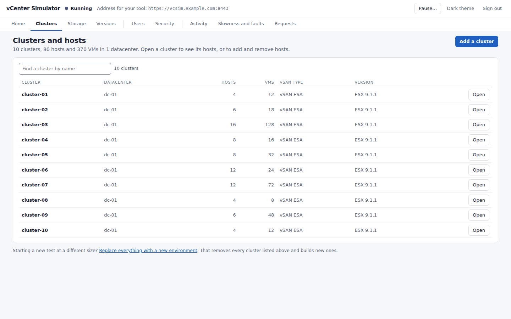
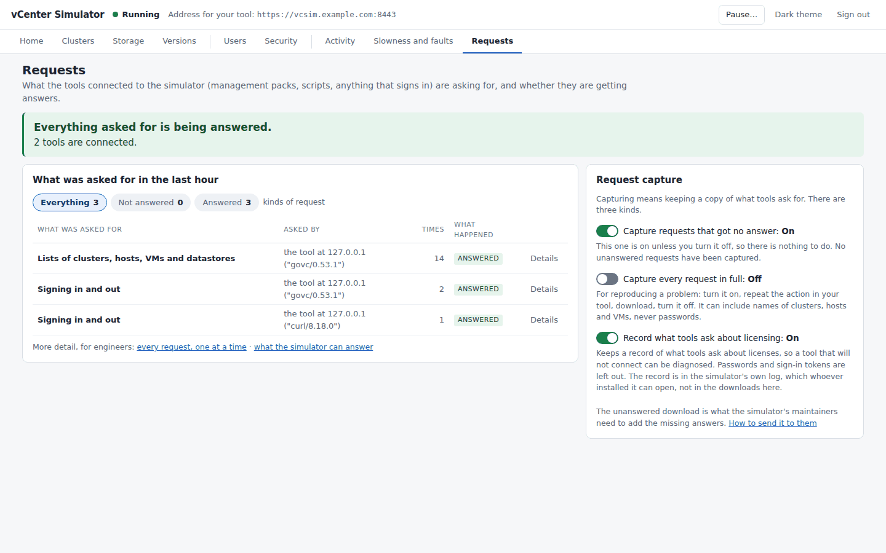

# vCenter API Simulator

A stand-in vCenter for testing tools that collect from vCenter: VCF Operations
management packs, scripts, PowerCLI, govc. You point the tool at the simulator
instead of a real vCenter. The simulator pretends to be one vCenter with as
many datacenters, vSAN clusters, hosts and VMs as you ask for, answers the
same sign-in, inventory and vSAN requests, and makes up performance numbers
that stay inside the range a real vCenter showed.

It is not VMware software and not a supported emulator. It runs no VMs and
holds no real data: it only answers API requests, and only the ones listed
below. Use it in a lab, with made-up credentials.


## What it answers today

| A tool asks for | The simulator |
|---|---|
| Signing in and out, on SOAP (`/sdk`) and REST (`/api/session`, `/rest/com/vmware/cis/session`) | Answers, for the users you set up. Checked against a real vCenter 9.1.1. |
| Lists of datacenters, clusters, hosts, VMs, datastores and networks, on SOAP | Answers. Built on [govmomi vcsim](https://github.com/vmware/govmomi/tree/main/vcsim). |
| The same lists on REST (`/api/vcenter/...`), the vCenter version, and since v0.3.2 the appliance's Salt minion settings | Answers. Some details of VMs are missing. |
| vSAN performance data (`/vsanHealth`), for ESA and OSA clusters | Answers all 69 kinds. The values are made up, the same every time for the same moment, and inside the range a real vCenter showed. |
| vSAN settings, disk lists and the health summary | Answers. Some detailed health checks are missing. |
| Where vCenter's other services are (the lookup service, `/lookupservice/sdk`), how its sign-on is set up (`/sso-adminserver`), and a signed sign-on token for an account (`/sts`) | Answers, in the shapes a real vCenter 9.1.1 uses. The key that signs the token is the simulator's own. |
| Operations' inventory-relationship query (hosts, datacenters, clusters) and performance counter discovery (`/sdk`) | Answers, including 28 internal guest counters; GPU counter levels can be changed. |
| Tag collection through vAPI JSON (`POST /api`) | Answers sign-in, an empty tag list, and sign-out. |
| Standard vSphere performance (`/sdk`) and host/VM quickStats | Changing CPU, memory, storage and network values, with VM-to-host-to-cluster totals, realtime samples and historical rollups. [Semantics](docs/REFERENCE.md#standard-vsphere-performance). |
| Operations' GPU vStats query and live stream (`/api`, `/stats`) | Accepts the query and leaves the stream idle, matching GPU-less lab vCenters. Tokens use only the simulator's signing key. Direct connections to separate ESX endpoints are not simulated. |
| Appliance settings, backup lists, topology and supervisor discovery (`/api`) | Answers with invented appliance settings, no backups, no storage policies and no supervisors. |
| Licensing (the license service, `/ls/sdk`) | Answers that vCenter and its hosts are **in evaluation**, or that the evaluation has run out. It cannot say vCenter is licensed. |
| Which VCF Operations manages vCenter's license | Answers "none", or the one you name, or the one that registered itself. |
| The root certificate (`/rest/vcenter/certificate-authority/get-root`) | Answers. |
| iSCSI and NFS datastores | Answers when you add them. Capacity matches inventory; I/O follows the VMs using each datastore, and remains zero on unused stores. |
| Which version vCenter and its hosts are | Answers as 8.0 Update 3, 9.0 or 9.1.1, or a number you type. One cluster can hold a mix of ESX versions. |

Names and internal ids stay the same across restarts and changes (until you
replace everything with a new environment), so a tool that has already
collected keeps recognising what it saw. You can also make
the simulator slow or make it fail on purpose, to see how a tool copes.

## What it does not do yet

- **Whether VCF Operations 9.x will collect from it as a vCenter account is
  not known yet.** Operations asks a vCenter about its license before it
  collects ([#12](https://github.com/sentania-labs/vcenter-api-simulator/issues/12),
  [#14](https://github.com/sentania-labs/vcenter-api-simulator/issues/14)).
  The simulator now answers every request in that chain the way a real
  vCenter 9.1.1 does, up to saying it is in evaluation
  ([what it answers, and what is unverified](#licensing-and-sign-on)). It has
  been checked with the 9.1.1 adapter's own Java clients against a local
  simulator: lookup, license login and asset parsing, SSO admin construction,
  and the administrator licensing-group check all pass. The final proof is
  starting the adapters on the 9.1.1 development Operations instance; that
  has not been run for this change.
- **A licensed vCenter is not built.** A vCenter that is licensed presents a
  signed entitlement that only the vendor can issue. The simulator does not
  make one, copy one or accept one.
- **Management packs that bring their own collector do work.** The vSAN Host
  Metrics pack 2.0.0 collected from the simulator through a real VCF
  Operations 9.1.1 ([how that was checked](docs/OPERATIONS-ACCEPTANCE.md)).
- Not answered: the older license manager on the main interface (`/sdk`),
  and whether Kubernetes is turned on.
- Reported as absent: Fibre Channel storage, and vSAN acting as a file server
  or an iSCSI server.
- Distributed switches are there, but as the basic type rather than the
  VMware type.

The console's Requests screen shows what your tool asked for that got no
answer, and lets you download those requests to
[report them](https://github.com/sentania-labs/vcenter-api-simulator/issues/new).

## Licensing and sign-on

VCF Operations asks a vCenter a chain of questions before it collects: where
its sign-on service is, whether the account may manage licenses, what license
the vCenter has, and which Operations manages that license. The simulator
answers the chain with its own values only. No key, token, certificate or
license in it comes from a real system.

| Operations asks | The simulator answers |
|---|---|
| The lookup service for vCenter and its sign-on service | One registration each, with addresses built on the address the tool used and the certificate to trust for them |
| The sign-on admin service for its content, its domain, its SSL certificate manager and its signing certificate | `vsphere.local`, a typed manager reference, and the certificate of the simulator's own signing key |
| The token service for a token, with a username and password | A signed token for one of the simulator's accounts. It lists the groups that make an account a licensing administrator, unless you take them out |
| The license service for vCenter's own license and for every asset | vCenter and each host in evaluation with 90 days left, or with the evaluation run out. No licenses |
| Whether the extension `com.vmware.vrops.license.managed` is there | Not there, or there with the Operations id and address you typed, or as an Operations registered it. Registering, changing and removing it all work |
| To sign in with a session ticket | "The session ticket is invalid", as a real vCenter says to a ticket it did not issue |

The three choices are on the console's Security screen ("How licensing looks
to tools") and in the [scenario file](docs/SCENARIO.md#licensing).

**Behind a proxy that ends TLS** (an ingress), give the simulator that
proxy's certificate with `-lookup-trust-cert` (the chart's
`simulator.lookupTrustSecret`), and route `/lookupservice`,
`/sso-adminserver`, `/sts`, `/ls`, `/api`, `/rest` and `/stats` to it as well
as `/sdk`. The lookup service tells a tool which certificate to trust at the
sign-on addresses, and behind a proxy that is the proxy's, not the simulator's.

**Not built:** a licensed vCenter (see above), assigning a license to the
simulator, the REST lists of license assignments, session tickets that work
(`AcquireSessionTicket`), and an unfiltered lookup list (a real vCenter
returns about 48 registrations, the simulator none).

**Unverified.** The answers were built from what three real vCenter 9.1.1
systems returned and from what the Operations adapter reads. These parts
were not observed, so the simulator's answer is its own:

- Lookup service: the values of the `GroupInternalId`, `ControlScript` and
  `Capabilities` attributes and of the site id (only their lengths were
  seen), the owner name of the sign-on registration, the text of the fault
  for a wrong reference (its type was seen), and whether the session cookie
  repeats from one answer to the next. The `localurl` attribute names port
  8085, which the simulator does not serve.
- Sign-on admin: the value of `apiRevision` and the simulator-owned SSL
  certificate-manager reference value. Only the four reads above are answered.
- Token service: the request it accepts is the standard form a real vCenter
  accepted, not one captured from Operations. The answer to a wrong password
  is the standard WS-Security fault; a real vCenter's was never seen. The
  given name and surname in the token are taken from the account name. A
  read-only account is listed in `Everyone` only.
- License service: every real vCenter observed was licensed, so vCenter's
  asset in evaluation is put together from the evaluation block those assets
  carry and from one host that was in evaluation. For hosts, the asset id,
  the product id and name, and the cost units (processors and cores only) are
  the simulator's own. So are the hours and minutes left, the 90 days, an
  evaluation that never counts down, what an expired evaluation looks like,
  and the fault for a read that is not signed in. The `disallowedHostEditions`
  property and vSAN assets are left out.
- The "managed by" extension: the subject name is left out unless an
  Operations registered one, and the version is vCenter's own unless an
  Operations registered another.

The simulator writes what tools ask of these services to its log, with
usernames, passwords, tickets, tokens and certificates removed, so that the
gaps above can be closed from what Operations really sends
([reference](docs/REFERENCE.md#the-simulator-its-flags-and-what-a-scenario-controls)).

## Run it

```sh
docker run -d --name vcsim -p 8443:8443 -p 127.0.0.1:9090:9090 -v vcsim-data:/data \
  --read-only --tmpfs /tmp --cap-drop ALL --security-opt no-new-privileges \
  ghcr.io/sentania-labs/vcenter-api-simulator:main
```

1. Open the console at `http://127.0.0.1:9090/`. The first visit asks you to
   choose a password for the console, then a password for
   `administrator@vsphere.local`, the account tools sign in with. There is no
   default password.
2. Point your tool at `https://<this machine>:8443` with that account. The
   certificate is made by the simulator, so the tool will ask whether to
   trust it.
3. Home shows the tool once it connects.

It starts as one cluster of 4 hosts. Grow it from the console, or start it
with a [scenario file](docs/SCENARIO.md).

`:main` is the current main branch. Releases are tagged `vX.Y.Z`, and
`latest` is the newest release. The console described here is in `main` and
in releases after v0.3.2.

Other ways to run it, all in the [reference](docs/REFERENCE.md#running-it):

- **Docker Compose:** `docker compose up -d` with the
  [`docker-compose.yml`](docker-compose.yml) in this repository. Same ports.
- **Helm:** `helm install vcsim-01 charts/vcenter-api-simulator --set hostname=vcsim-01.example.test`
  installs one simulated vCenter per release. The console stays inside the
  pod until you ask for it; the chart's notes print the `kubectl port-forward`
  command that opens it. The state volume is `persistence.size` (1Gi by
  default), enough for the query log's cap plus the state files; the Helm
  section of [the reference](docs/REFERENCE.md) says what an existing install
  with an older claim does.
- **From source:** `go build ./cmd/vcsimulator`, then
  `./vcsimulator -scenario examples/scenarios/ten-clusters.yaml -data ./data`.

See [inventory sizing and probes](docs/sizing.md) before growing an environment.

## Change what it simulates

Use the console. Its tabs are named for what you want to do: Home, Clusters,
Storage, Versions, Users, Security, Slowness and faults, Requests.



Every change works the same way. A short screen asks a few questions that
are already filled in. Beside them, "What will happen" says in plain
sentences what the change will do. One button makes it, right away or later
the same day.


| To | Go to |
|---|---|
| Add or remove clusters and hosts, or change their hardware | Clusters |
| Add iSCSI or NFS datastores, or disconnect hosts from them | Storage |
| Change the vCenter or ESX version | Versions |
| Add, change or remove the accounts tools sign in with | Users |
| Replace the certificate, sign idle tools out, change the console password, change how licensing looks to tools | Security |
| Make requests slow or fail on purpose | Slowness and faults |
| See what your tool asks for and what got no answer | Requests |

Adding or removing clusters, hosts, storage or versions signs connected tools
out, as a vCenter restart would; they sign in again by themselves.



Every screen, with the screens of the previous console beside it, is in
[docs/console](docs/console/README.md). The same settings can be written in a
[scenario file](docs/SCENARIO.md) instead.

## More

- [Reference](docs/REFERENCE.md): every flag, request capture, the console
  password and certificate, Docker, Compose, Helm and Argo CD in detail, and
  how the checks are run
- [Scenario file](docs/SCENARIO.md)
- [Architecture](docs/ARCHITECTURE.md)
- [Testing](docs/TESTING.md) and the
  [Operations acceptance run](docs/OPERATIONS-ACCEPTANCE.md)
- [Roadmap](docs/ROADMAP.md), the [original specification](docs/SPECIFICATION.md)
  and the [first console's requirements](docs/UX-REQUIREMENTS.md)
- [Firstmate orchestration kickoff](FIRSTMATE-KICKOFF.md)

## Guardrails

**No live-vCenter access until the operator identifies how the worker should obtain a read-only credential.** Never request that the operator paste passwords or tokens into an issue, repository, PR, chat transcript, logs, or agent handoff. Do not commit raw customer/lab inventory captures. Sanitize and review fixtures before publishing.

This simulator is designed for a controlled lab; never advertise it as VMware/Broadcom vCenter, ESX or vSAN software or a supported emulator. See [SPECIFICATION](docs/SPECIFICATION.md) for explicit validation gates.
