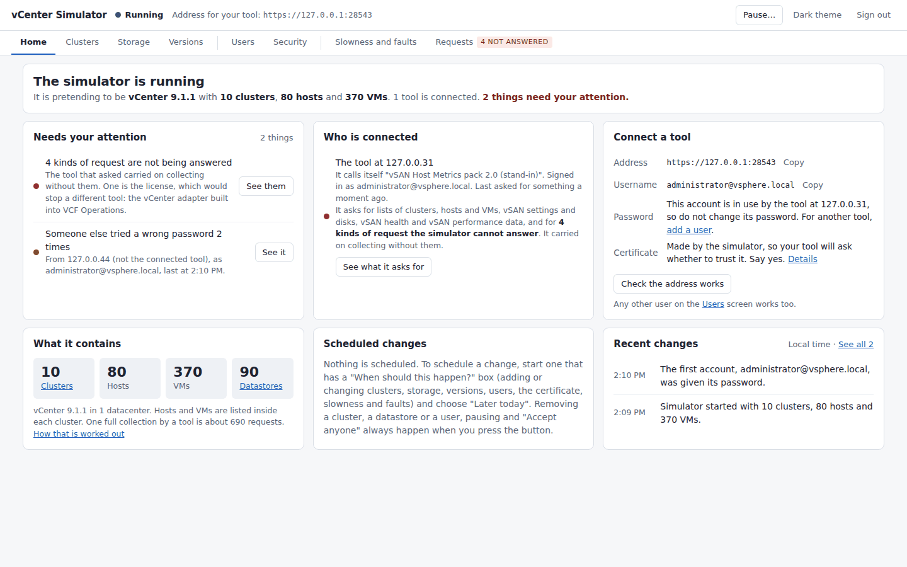
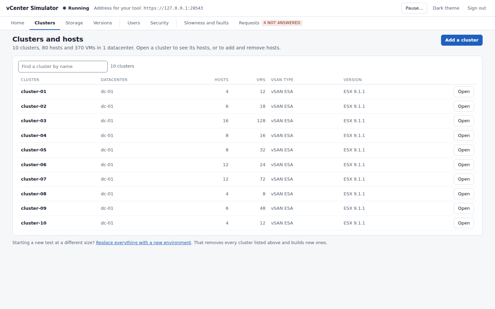
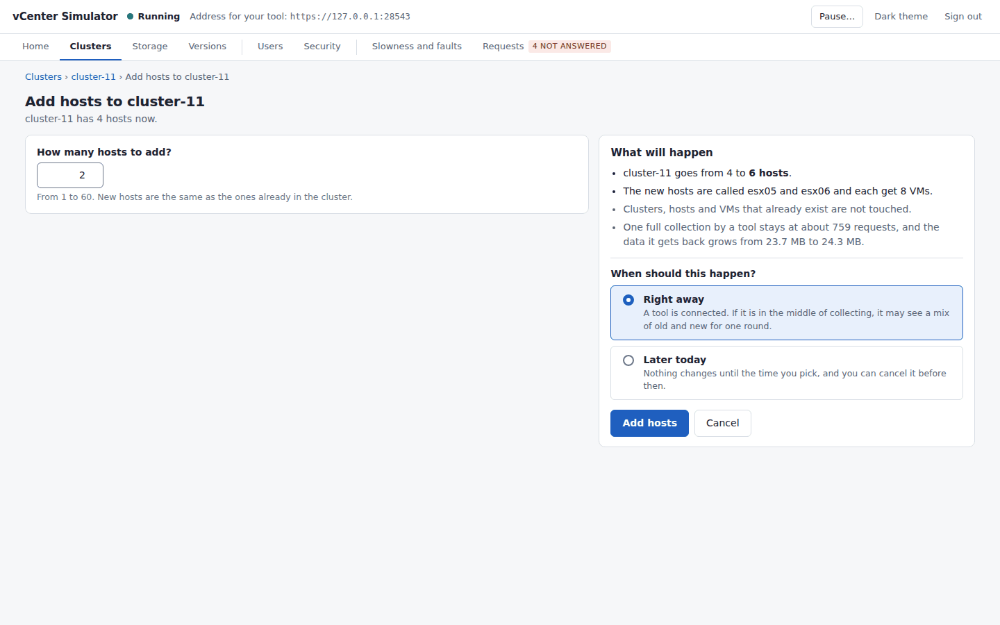
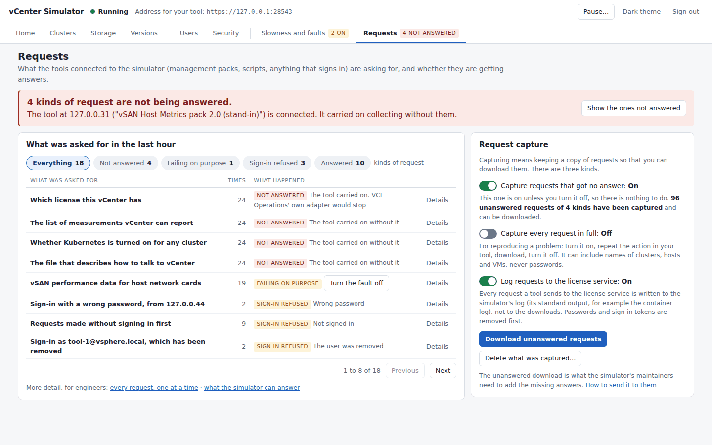

# vCenter API Simulator

A stand-in vCenter for testing tools that collect from vCenter: VCF Operations
management packs, scripts, PowerCLI, govc. You point the tool at the simulator
instead of a real vCenter. The simulator pretends to be one vCenter with as
many datacenters, vSAN clusters, hosts and VMs as you ask for, answers the
same sign-in, inventory and vSAN requests, and makes up performance numbers
that stay inside the range a real vCenter showed.

It is not VMware software and not a supported emulator. It runs no VMs and
holds no real data: it only answers API requests, and only the ones listed
below. Use it in a lab, with made-up credentials.



## What it answers today

| A tool asks for | The simulator |
|---|---|
| Signing in and out, on SOAP (`/sdk`) and REST (`/api/session`) | Answers, for the users you set up. Checked against a real vCenter 9.1.1. |
| Lists of datacenters, clusters, hosts, VMs, datastores and networks, on SOAP | Answers. Built on [govmomi vcsim](https://github.com/vmware/govmomi/tree/main/vcsim). |
| The same lists on REST (`/api/vcenter/...`), the vCenter version, and since v0.3.2 the appliance's Salt minion settings | Answers. Some details of VMs are missing. |
| vSAN performance data (`/vsanHealth`), for ESA and OSA clusters | Answers all 69 kinds. The values are made up, the same every time for the same moment, and inside the range a real vCenter showed. |
| vSAN settings, disk lists and the health summary | Answers. Some detailed health checks are missing. |
| The license service's sign-in and sign-out (`/ls/sdk`), the lookup service (`/lookupservice/sdk`), and the root certificate (`/rest/vcenter/certificate-authority/get-root`) | Answers. Licenses themselves are not modelled. |
| iSCSI and NFS datastores | Answers when you add them. Their activity counters read zero. |
| Which version vCenter and its hosts are | Answers as 8.0 Update 3, 9.0 or 9.1.1, or a number you type. One cluster can hold a mix of ESX versions. |

Names and internal ids stay the same across restarts and changes (until you
replace everything with a new environment), so a tool that has already
collected keeps recognising what it saw. You can also make
the simulator slow or make it fail on purpose, to see how a tool copes.

## What it does not do yet

- **VCF Operations cannot yet use it as a vCenter account.** When you save the
  account, Operations asks the vCenter license service (`/ls/`). The simulator
  answers only its sign-in and sign-out, not the licensing itself, so
  Operations warns that license management is unavailable and then refuses to
  start collecting, because the account has no VCF license
  ([#12](https://github.com/sentania-labs/vcenter-api-simulator/issues/12),
  [#14](https://github.com/sentania-labs/vcenter-api-simulator/issues/14)).
  This is being worked on: the simulator writes every request to the license
  service to its log, with secrets removed, so that the answers can be built
  from what Operations really asks.
- **Management packs that bring their own collector do work.** The vSAN Host
  Metrics pack 2.0.0 collected from the simulator through a real VCF
  Operations 9.1.1 ([how that was checked](docs/OPERATIONS-ACCEPTANCE.md)).
- Not answered: the list of performance counters vCenter can report, which
  license vCenter has, and whether Kubernetes is turned on.
- Reported as absent: Fibre Channel storage, and vSAN acting as a file server
  or an iSCSI server.
- Distributed switches are there, but as the basic type rather than the
  VMware type.

The console's Requests screen shows what your tool asked for that got no
answer, and lets you download those requests to
[report them](https://github.com/sentania-labs/vcenter-api-simulator/issues/new).

## Run it

```sh
docker run -d --name vcsim -p 8443:8443 -p 127.0.0.1:9090:9090 -v vcsim-data:/data \
  --read-only --tmpfs /tmp --cap-drop ALL --security-opt no-new-privileges \
  ghcr.io/sentania-labs/vcenter-api-simulator:main
```

1. Open the console at `http://127.0.0.1:9090/`. The first visit asks you to
   choose a password for the console, then a password for
   `administrator@vsphere.local`, the account tools sign in with. There is no
   default password.
2. Point your tool at `https://<this machine>:8443` with that account. The
   certificate is made by the simulator, so the tool will ask whether to
   trust it.
3. Home shows the tool once it connects.

It starts as one cluster of 4 hosts. Grow it from the console, or start it
with a [scenario file](docs/SCENARIO.md).

`:main` is the current main branch. Releases are tagged `vX.Y.Z`, and
`latest` is the newest release. The console described here is in `main` and
in releases after v0.3.2.

Other ways to run it, all in the [reference](docs/REFERENCE.md#running-it):

- **Docker Compose:** `docker compose up -d` with the
  [`docker-compose.yml`](docker-compose.yml) in this repository. Same ports.
- **Helm:** `helm install vcsim-01 charts/vcenter-api-simulator --set hostname=vcsim-01.example.test`
  installs one simulated vCenter per release. The console stays inside the
  pod until you ask for it; the chart's notes print the `kubectl port-forward`
  command that opens it.
- **From source:** `go build ./cmd/vcsimulator`, then
  `./vcsimulator -scenario examples/scenarios/ten-clusters.yaml -data ./data`.

## Change what it simulates

Use the console. Its tabs are named for what you want to do: Home, Clusters,
Storage, Versions, Users, Security, Slowness and faults, Requests.



Every change works the same way. A short screen asks a few questions that
are already filled in. Beside them, "What will happen" says in plain
sentences what the change will do. One button makes it, right away or later
the same day.



| To | Go to |
|---|---|
| Add or remove clusters and hosts, or change their hardware | Clusters |
| Add iSCSI or NFS datastores, or disconnect hosts from them | Storage |
| Change the vCenter or ESX version | Versions |
| Add, change or remove the accounts tools sign in with | Users |
| Replace the certificate, sign idle tools out, change the console password | Security |
| Make requests slow or fail on purpose | Slowness and faults |
| See what your tool asks for and what got no answer | Requests |

Adding or removing clusters, hosts, storage or versions signs connected tools
out, as a vCenter restart would; they sign in again by themselves.



Every screen, with the screens of the previous console beside it, is in
[docs/console](docs/console/README.md). The same settings can be written in a
[scenario file](docs/SCENARIO.md) instead.

## More

- [Reference](docs/REFERENCE.md): every flag, request capture, the console
  password and certificate, Docker, Compose, Helm and Argo CD in detail, and
  how the checks are run
- [Scenario file](docs/SCENARIO.md)
- [Architecture](docs/ARCHITECTURE.md)
- [Testing](docs/TESTING.md) and the
  [Operations acceptance run](docs/OPERATIONS-ACCEPTANCE.md)
- [Roadmap](docs/ROADMAP.md), the [original specification](docs/SPECIFICATION.md)
  and the [first console's requirements](docs/UX-REQUIREMENTS.md)
- [Firstmate orchestration kickoff](FIRSTMATE-KICKOFF.md)

## Guardrails

**No live-vCenter access until the operator identifies how the worker should obtain a read-only credential.** Never request that the operator paste passwords or tokens into an issue, repository, PR, chat transcript, logs, or agent handoff. Do not commit raw customer/lab inventory captures. Sanitize and review fixtures before publishing.

This simulator is designed for a controlled lab; never advertise it as VMware/Broadcom vCenter, ESX or vSAN software or a supported emulator. See [SPECIFICATION](docs/SPECIFICATION.md) for explicit validation gates.
