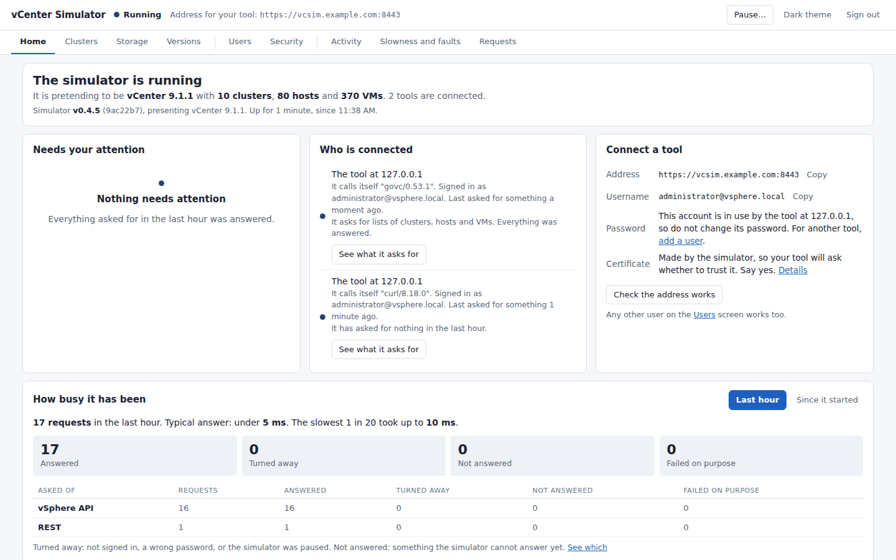
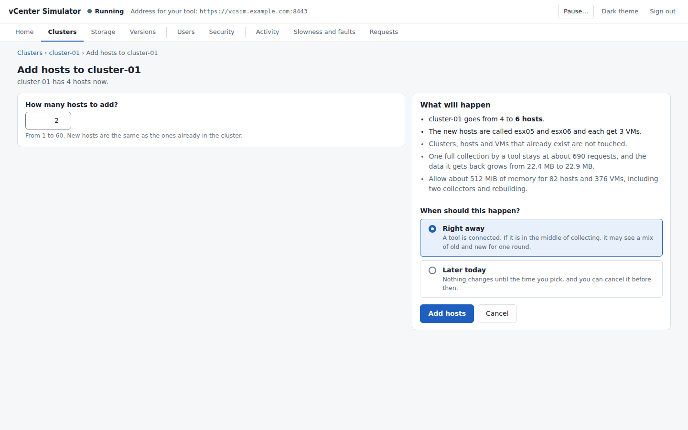
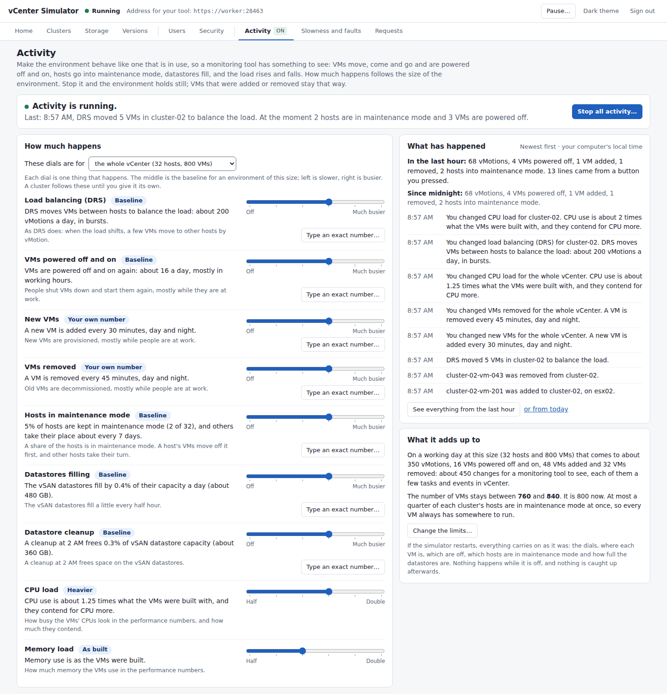

# vCenter API Simulator

A pretend vCenter for testing. Point VCF Operations, a management pack, PowerCLI,
govc or your own script at it instead of a real vCenter. It answers the sign-in,
inventory, performance and vSAN requests those tools make, for as many
datacenters, vSAN clusters, hosts and VMs as you ask for. It can also change by
itself, the way a busy environment does.

It runs no VMs and holds no real data. It is not VMware or Broadcom software,
and not a supported emulator. Use it in a lab, with made-up credentials.



## Status

A community project, released as is under the MIT license. Please report what you
find as [issues](https://github.com/sentania-labs/vcenter-api-simulator/issues).

| | |
|---|---|
| Presents as | vCenter 8.0 Update 3, 9.0 or 9.1.1 (the default). ESX hosts can be a different version |
| Get it | [Releases](https://github.com/sentania-labs/vcenter-api-simulator/releases), and the image `ghcr.io/sentania-labs/vcenter-api-simulator` |
| Checked with | govc and PowerCLI. The vSAN Host Metrics 2.0.0 pack collecting through VCF Operations 9.1.1 was checked with simulator v0.2.0 on 2026-11-07, not since ([details](docs/development.md#what-has-been-checked)) |
| Not confirmed | VCF Operations' own vCenter adapter collecting from it, not yet run against any simulator version ([#14](https://github.com/sentania-labs/vcenter-api-simulator/issues/14)) |

## Run it

```sh
docker run -d --name vcsim -p 8443:8443 -p 127.0.0.1:9090:9090 -v vcsim-data:/data \
  --read-only --tmpfs /tmp --cap-drop ALL --security-opt no-new-privileges \
  ghcr.io/sentania-labs/vcenter-api-simulator:latest
```

1. Open the console at `http://127.0.0.1:9090/`. It asks you to choose a
   password for the console, then a password for `administrator@vsphere.local`,
   the account your tool signs in with. There is no default password.
2. In your tool, add a vCenter at `https://<this machine>:8443` with that
   account. The certificate is made by the simulator, so the tool asks whether
   to trust it.
3. Home shows the tool once it connects.

To check from a shell, set `GOVC_URL=https://localhost:8443/sdk`, `GOVC_USERNAME`,
`GOVC_PASSWORD` and `GOVC_INSECURE=1`, then run `govc about`.

It starts as one cluster of 4 hosts and 4 VMs. The `vcsim-data` volume keeps its
identities, certificate and console settings, so a restart changes nothing a tool
has already seen.

Things to know before you connect:

- **The address on Home is the container's own name.** Use your machine's name
  in the tool. To make Home show it too, add `-e VCSIM_PUBLIC_URL=https://<name>:8443`
  before the image name. If the tool checks names on the certificate, add
  `-tls-names=<name>` after the image name. That takes effect when the
  certificate is first made; to change it later use Security in the console.
- **Give each simulator its own seed** (`-seed=<name>` after the image name)
  when one tool will watch more than one. The same seed means the same vCenter
  identity.
- **Pin a version.** `latest` is the newest release and `main` is unreleased.
  Releases are tagged `vX.Y.Z`.

Other ways to run it:

- **Docker Compose:** `docker compose up -d` with [`docker-compose.yml`](docker-compose.yml).
  Same ports. Options are in the [reference](docs/REFERENCE.md#docker-compose).
- **Kubernetes (Helm):** one simulated vCenter per release. See the
  [chart's README](charts/vcenter-api-simulator/README.md).
- **From source** (Go 1.26.5 or newer): `go build ./cmd/vcsimulator`, then
  `./vcsimulator -scenario examples/scenarios/ten-clusters.yaml -data ./data`.
  Every start-up flag is in the [reference](docs/REFERENCE.md#start-up-flags-and-environment-variables).

## Shape the environment

Use the console. Its tabs are named for what you want to do.

| To | Go to |
|---|---|
| Add or remove clusters and hosts, or change their hardware | Clusters |
| Add iSCSI or NFS datastores, or disconnect hosts from them | Storage |
| Change the vCenter or ESX version, or mix versions in a cluster | Versions |
| Add, change or remove the accounts tools sign in with | Users |
| Replace the certificate, sign idle tools out, change the console password, change how licensing looks to tools | Security |
| Make the environment change by itself: vMotions, power changes, new and removed VMs, maintenance mode, datastores filling, CPU and memory load | Activity |
| Make requests slow or fail on purpose | Slowness and faults |
| See what your tool asks for, what got no answer, and download requests to report | Requests |

Every change is one short screen. "What will happen" says in plain sentences what
the button will do, and you can run it now or later the same day.



Changes to clusters, hosts, storage and versions sign connected tools out, as a
vCenter restart would. They sign in again by themselves. Everything else changes
in place. Identities stay the same across restarts and changes, so a tool that has
already collected keeps recognising what it saw.



Activity is off until you start it. Each thing it does is recorded as the events
and task a real vCenter 9.1.1 records for it ([how it works](docs/REFERENCE.md#activity)).
The same settings can be written in a [scenario file](docs/SCENARIO.md). Every
console screen is in [docs/console](docs/console/README.md).

## What it simulates

| A tool asks for | The simulator |
|---|---|
| Signing in and out (SOAP `/sdk`, REST `/api/session`) | Answers, for the accounts you set up |
| Datacenters, clusters, hosts, VMs, datastores, networks (SOAP and REST) | Answers, including legacy REST reads. Some details of VMs on REST are missing |
| vSAN performance (`/vsanHealth`), all 69 kinds, ESA and OSA | Answers with made-up values inside the range a real vCenter showed |
| vSAN settings, disks, health summary, resync summary | Answers. Some detailed health checks are missing. The resync summary says nothing is syncing |
| vSphere performance counters and values for VMs, hosts, clusters, datastores | Answers with changing values that add up from VM to host to cluster |
| iSCSI and NFS datastores | Answers when you add them. Their I/O follows the VMs using them |
| Version, appliance settings, networking, time and backup lists | Answers with made-up values. The appliance's hostname, DNS servers and address are the simulator's own |
| Lookup, sign-on, token and license services | Answers as an evaluation vCenter ([details](docs/REFERENCE.md#licensing-and-sign-on)) |
| Tags, storage policies, Kubernetes (`/wcp`), GPU statistics (`/stats`) | Answers "none", as a vCenter with none of them does |

The exact list is in the [reference](docs/REFERENCE.md#what-is-and-is-not-answered).

## Limits

**Not simulated**
- Nothing runs. No VM boots, no host exists, and tools that connect to a host
  directly (ESX health reports, for example) get no answer. VCF Operations logs
  "No ESX health reports found" for each host, and real lab vCenters do too.
- Distributed switches are served as the basic type, not the VMware type.
- Fibre Channel storage, and vSAN acting as a file server or an iSCSI server,
  are reported as absent. NFS 4.1, CHAP and rescans are not modelled.
- Alarms. Nothing Activity does raises one. Activity does not yet patch hosts one
  after another, take backups or snapshots, or crash a host.
- Session tickets (`AcquireSessionTicket`) and an unfiltered lookup list.

**Made up**
- Performance values are made up. They are the same every time for the same
  moment, stay inside the range a real vCenter showed, and follow a working day.
- Hardware, host names (`*.sim.invalid`), storage connection details and
  appliance account settings are invented. Datastore filling changes the vSAN
  datastore only.
- The key that signs sign-on tokens is the simulator's own.

**With VCF Operations**
- It is not confirmed that Operations' own vCenter adapter will collect from the
  simulator. It asks a vCenter about its license first, and the simulator
  answers every one of those questions the way a real 9.1.1 vCenter does, up to
  "in evaluation". The last step, starting the adapter against it, has not been run
  ([#14](https://github.com/sentania-labs/vcenter-api-simulator/issues/14)).
- Management packs that bring their own collector are expected to work. The
  vSAN Host Metrics 2.0.0 pack collected from simulator v0.2.0 through
  Operations 9.1.1 on 2026-11-07. It has not been run against later versions.
- Behind a shared ingress address, Operations' DNS alert is raised. It looks up
  the ingress address itself, which the simulator cannot change.

**Licensing.** It presents as an evaluation vCenter, with 90 days left or run
out. It never presents a licensed one, assigns a license, or works around licensing.
Accounts and keys come from the simulator only.

**Security.** For a lab, not a production network, and never with real
credentials.
- The certificate is self-signed. You can replace it on Security.
- The console is plain HTTP and listens on loopback unless you publish it. Use
  TLS in front of it if you do. Its password is separate from the vCenter accounts.
- There is no default password. `-any-login` accepts any account and password.
- Request capture can hold inventory identifiers. Passwords and tokens are left out.

The Requests screen lists what your tool asked for that got no answer. You can
download those requests and [report them](https://github.com/sentania-labs/vcenter-api-simulator/issues/new).

## Size it

The default environment is small: 512Mi of memory and one CPU are plenty. For
**215 hosts and 5,000 VMs**, give it 2Gi and two CPUs, and a data volume of at
least 1Gi. The console warns before a change that will not fit. Measurements and the probes a
Kubernetes deployment uses are in [sizing](docs/sizing.md).

## Upgrade it

Pull the new image and start it on the same volume. Identities, the certificate and
console settings carry over.

- **From 0.3.x:** the old default password is gone. With no account, every sign-in
  is refused until the console's set-up chooses a password. Existing accounts keep
  theirs.
- **Helm:** see [Upgrading](charts/vcenter-api-simulator/README.md#upgrading) for
  the volume size.
- A different seed changes every identity, and the simulator will not start with
  one unless you add `-regenerate`.

## Documentation

- [Reference](docs/REFERENCE.md): every flag and setting, what is and is not
  answered, request capture, Activity, licensing and sign-on
- [Scenario file](docs/SCENARIO.md), [sizing](docs/sizing.md),
  [console screens](docs/console/README.md), [Helm chart](charts/vcenter-api-simulator/README.md)

## For contributors

[docs/development.md](docs/development.md): how the simulator is built and tested,
and what has been checked against VCF Operations.

## License

MIT. See [LICENSE](LICENSE).
